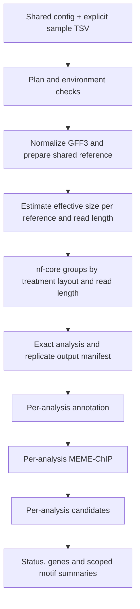

# Batch DAP-seq workflows (1.2.9)

Use one project config and one explicit sample table to process multiple TFs
against a shared reference. The batch ends at **candidates**. It does not run IDR,
lookup, tracks, signal plots or external GO enrichment services. Existing
single-project commands and their default paths remain available.
The batch launcher requires Python 3.9 or newer (the supplied runtime environment
uses Python 3.11).

The initial implementation supports **nf-core/chipseq 2.1.0, BWA, narrow peaks,
local execution**, with DAP-seq sample semantics. It does not batch ATAC-seq or
submit to a cluster scheduler. Do not mix species/reference assemblies in one batch.

## Quick start

```bash
chromaflow batch init /data/projects/MyDAPbatch
cd /data/projects/MyDAPbatch
# Edit chromaflow.config: source FASTA/GFF3, offline bundle and environment names.
# Replace the example samples.tsv with the actual experimental design.
chromaflow batch plan --samples samples.tsv --check-env
chromaflow batch run --samples samples.tsv --until reference
chromaflow batch run --samples samples.tsv --resume --until nfcore
chromaflow batch run --samples samples.tsv --resume
chromaflow batch status
# Refresh separate diagnostic plots for the unchanged saved run:
chromaflow batch reports
```

`-c /path/to/chromaflow.config` is accepted after each batch subcommand.
`--samples` is relative to the shell working directory. `--only TF_A_col,TF_B_col`
selects exact analysis IDs and includes their controls automatically. It is
available for `plan`, `run` and `reports`; no regex or partial-ID matching is performed.
`--until annotate` and `--until motif` also work. No confirmation is requested
after an explicit `batch run`; use `plan` to review the design before starting.

The complete 1.2.9 installation includes the earlier resume/report fixes. `batch reports`
reconstructs and verifies existing annotations, then writes diagnostic figures
under `results/analyses/<id>/reports/annotation/`. It does not run nf-core or
MEME-ChIP or overwrite the batch status summary, including with `--only`.
The saved config must be unchanged. `plot_status.tsv` records written/skipped/
failed plots. Repeating the command reuses verified reports. Old candidate
version-label typos are corrected with backups and no change to scientific fields.

`plan` samples up to 2,000 records from each selected FASTQ, checks mate names,
layout, file presence and control assignments, measures read lengths, and hashes
reference inputs. It writes proposed native nf-core CSVs for inspection. It does
not run reference processing or nf-core. This is not a full FASTQ integrity scan;
use `gzip -t` separately if transfer integrity is uncertain.

## Sample-table contract

See [the TSV example](../templates/samples_batch.tsv). Every row is one sequencing
run. Extra columns are retained in the plan, so public accessions, original
replicate labels, gene IDs and sample descriptions need not be discarded.

| Column | Meaning |
|---|---|
| `analysis_id` | One TF + condition + its biological replicates; empty for controls |
| `sample_id` | Equals `analysis_id` for targets; a distinct name for a control sample |
| `role` | Exactly `target` or `control` |
| `replicate` | Biological replicate number, consecutive from 1 within each sample |
| `layout` | Explicit `SE` or `PE`; no automatic fallback if a mate is missing |
| `fastq_1`, `fastq_2` | Absolute paths or paths relative to `RAW_DATA_DIR`; SE has empty mate 2 |
| `control`, `control_replicate` | Exact control sample and replicate; required for every target |
| `target`, `condition` | Original biological identity/condition, consistent within an analysis |
| `run_accession` | Original run accession or local run label |
| `read_length` (optional) | Reviewed per-run k override; otherwise measured from FASTQ |

Use letters, digits and underscores for `sample_id`/`analysis_id`, beginning with
a letter. `_REP` is reserved for nf-core filenames. Biological `target` and gene
IDs are not rewritten. FASTQs cannot be assigned twice. Technical runs share the
same `sample_id` and `replicate` and are merged by nf-core; they are not counted as
additional biological replicates. Technical runs must have the same control.

The upstream 2.1.0 validator requires FASTQ filenames ending in `.fastq.gz` or
`.fq.gz` and forbids spaces. Batch also rejects commas/quotes/newlines in FASTQ
paths rather than generating a malformed CSV. No files are renamed.

List shared controls once. They are processed once **within each compatible
nf-core group**; separate groups may process the control again. When a control
sample has multiple biological replicates, all of its replicates are included so
the native consecutive numbering requirement remains satisfied, but treatment
assignments still use the explicitly chosen replicate.

Do not infer controls from filenames or species alone. An SE treatment with a PE
control is disabled by default. A reviewed project can set
`BATCH_ALLOW_SE_WITH_PE_CONTROL=true`: nf-core aligns the control as PE, while
MACS3 uses the treatment's BAM/SE interpretation. This is not identical to PE
fragment counting. PE treatment with SE control is rejected. This switch only
permits the design; it does not establish biological control suitability.

## Shared work and isolation



Reference identities use SHA256 of source FASTA, GFF3 and optional organelles/type
map. Generated references live in a versioned reference directory, so changed
sources cannot silently reuse an older manifest. Chromosome names are checked
before nf-core. The builtin conservative GFF normalization and existing GTF
conversion/identity checks are reused; this is not a new species-specific parser.
The FASTA is copied/decompressed once into the project's shared reference area,
so indexing does not write sidecar files beside a shared source FASTA.

Effective genome size is estimated once per reference identity and k. A global
`READ_LENGTH` is rejected. Conflicting read lengths across runs of one analysis
require explicit reviewed TSV overrides. A numeric `MACS_GSIZE` config override
is supported and recorded; otherwise `unique-kmers.py` must work. Batch does not
silently use a non-N-base upper-bound fallback.

Measured/configured
`MACS_GSIZE` is sent to nf-core without its redundant `read_length` parameter.
This avoids the pinned pipeline's read-length enum for values such as 130 while
retaining the real k in estimation and provenance. This behavior is included
in the full 1.2.9 package; no separate patch is needed.

Compatible analyses share one nf-core invocation with distinct `antibody` keys
equal to their analysis IDs. A completed group's saved BWA index is reused by
subsequent groups when available. The group manifest binds exact sample/replicate
filenames; it never takes the first consensus in a directory. Multiple biological
replicates require the native per-analysis consensus. A singleton uses its own
narrowPeak, retaining summit coordinates and placing MACS signalValue in the
downstream score column. Its provenance says `single_replicate_no_idr`.

`consensus` is the batch branch name; **a singleton is not evidence of replicate
reproducibility**. No result from a different TF is used to make a consensus or
populate signal values. ChIPseeker promoter parameters and candidate feature/
motif filters retain their existing meanings; no new ID or promoter heuristics
are introduced.

## Environments and resources

Default `BATCH_ENV_MODE=conda` uses `conda run --no-capture-output` with the
environment names/prefixes in [batch.config](../templates/batch.config):

| Stage | Default environment |
|---|---|
| reference and k-mer size | `ChromaFlow_ref` |
| offline nf-core launcher | `ChromaFlow_runtime` |
| annotation | `ChromaFlow_R` |
| motif | `ChromaFlow_motif` |
| candidates | `ChromaFlow_downstream` |

Set `BATCH_CONDA_EXE` if Conda is not on PATH. Environment values can be absolute
prefixes, which is useful for shared installations. The batch does not install or
mutate environments. `chromaflow setup --mode offline` remains the installation
command; use existing environments only after `batch plan --check-env` passes.
Offline bundles do not contain these downstream environments. `BATCH_ENV_MODE=current`
is an explicit option for a user-managed environment containing all required tools.

Preflight records executable paths and relevant versions, checks required R
packages, and runs the offline bundle runtime check. Activation from an unrelated
Conda environment does not choose the batch's analysis environment. Bundled
Nextflow is used in offline mode; Nextflow need not be on the calling shell's PATH.

Groups and downstream analyses run serially. Within nf-core, the local executor
gets a total CPU/memory budget from `MAX_CPUS`/`MAX_MEMORY`, in addition to the
per-task limits. `BATCH_MEME_THREADS` is bounded by `MAX_CPUS`; BLAS thread pools
are limited to one. The executor config is added explicitly even for offline
`-C` execution. No cross-TF differential binding is requested (`--skip_deseq2_qc`).

## Outputs, logs and recovery

```text
<OUTPUT_DIR>/
  reference/batch/<reference-identity>/
  results/nfcore/se_k150/                 native workflow outputs
  results/analyses/<analysis_id>/
    inputs.json                         source files and replicate provenance
    analysis_status.json                current status; check before using outputs
    annotation/  motif/  candidates/
  results/summary/
    batch_status.tsv                    success, failure and unevaluable analyses
    candidate_genes.tsv                 exact gene IDs with analysis/target columns
    motifs.tsv                          analysis_id::motif_id avoids name collisions
    batch_summary.json
  logs/batch/                           master terminal logs and nf-core logs
  logs/analyses/<analysis_id>/           per-step logs, including stderr/exit code
  work/batch/<group>/                    keep for Nextflow resume
  .chromaflow/batch/                     plans, snapshots, manifests and stage hashes
```

Only shared source config + sample TSV need manual maintenance. Generated configs
under `.chromaflow` are snapshots, not additional user configuration files.

`--resume` requires matching input/config/tool/code signatures and SHA256 of
recorded outputs. FASTQ identity defaults to path, size and nanosecond mtime;
`BATCH_FASTQ_SHA256=true` also hashes every full FASTQ for stricter assurance.
Changed filters rerun candidates without rerunning peak calling. Failed stages
are retried. With the [peak isolation update](PEAK_ISOLATION_HOTFIX.md), a failed
MACS3 task is isolated within its shared group. Fresh task traces and expected
files gate every analysis: `model_failed`, `peak_calling_failed` and
`nfcore_incomplete` remain distinct from successful zero-peak results. Partial
groups are not stamped complete. Other analyses proceed and the overall command
exits nonzero if a failure remains. Native workflow/global validation errors still
fail the group. Existing generated
outputs being replaced are moved into `.chromaflow/batch/archive/`; raw inputs are
not removed. Nextflow work directories remain available for task-level reuse.

No peaks and fewer than ten peaks are distinct statuses. With 1–9 peaks,
annotation can complete, but ChromaFlow skips MEME-ChIP/candidates as a small-input
policy. This is not a universal minimum enforced by every MEME tool. These cases,
failures and unrun analyses have `candidate_genes=NA`, not a fabricated zero.
Zero is reserved for a successful candidate evaluation that selected no genes.
Batch success means execution completed; examine these biological sufficiency
statuses and nf-core QC before interpreting candidates.

Summary files describe the **current invocation selection**, not a cumulative
cross-run matrix. After a smoke test, run the full table with `--resume` to obtain
the full project summary. A completed-looking older directory is not sufficient:
use `analysis_status.json`/`batch_status.tsv`. A project lock prevents concurrent
batch writers. Interruptions release the lock; rerun with `--resume`.

## Validation boundary

The [release acceptance helper](RELEASE_ACCEPTANCE.md) runs packaged regressions,
checks a full saved plan, resumes the real batch and verifies repeated report
refresh. It packages evidence without changing model parameters. The included
release compatibility record preserves validated predecessor stage identities
only while the installed runtime matches exactly; changed inputs, environments,
parameters and output files still invalidate reuse.

The release includes synthetic multi-TF regression tests, native CLI integration
tests, output-tampering/resume tests and single-project regressions. Expensive
nf-core/R/MEME producers are fixtures in the batch orchestration tests; candidate
integration runs the actual implementation. These tests do not replace a real
small-data run on the target server or validate a public dataset's biological
conclusions. Keep the smoke-test logs and native MultiQC reports for review.

Upstream contracts: [nf-core 2.1.0 output](https://nf-co.re/chipseq/2.1.0/docs/output),
[sample validation](https://github.com/nf-core/chipseq/blob/2.1.0/bin/check_samplesheet.py),
[consensus publishing](https://github.com/nf-core/chipseq/blob/2.1.0/conf/modules.config),
[MACS3 input format](https://github.com/nf-core/chipseq/blob/2.1.0/modules/nf-core/macs3/callpeak/main.nf).
